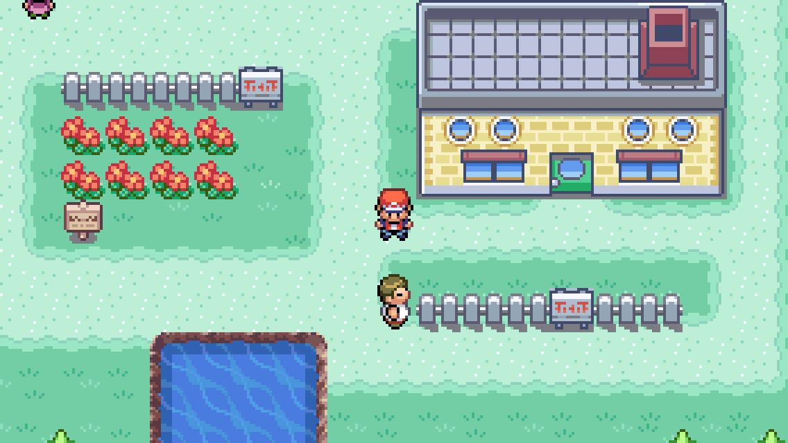
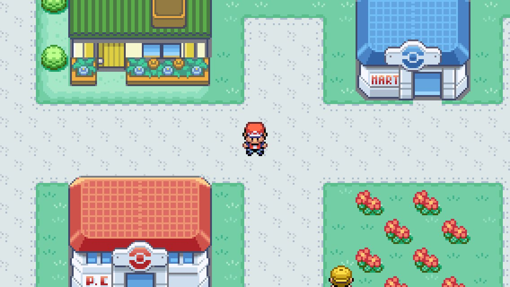
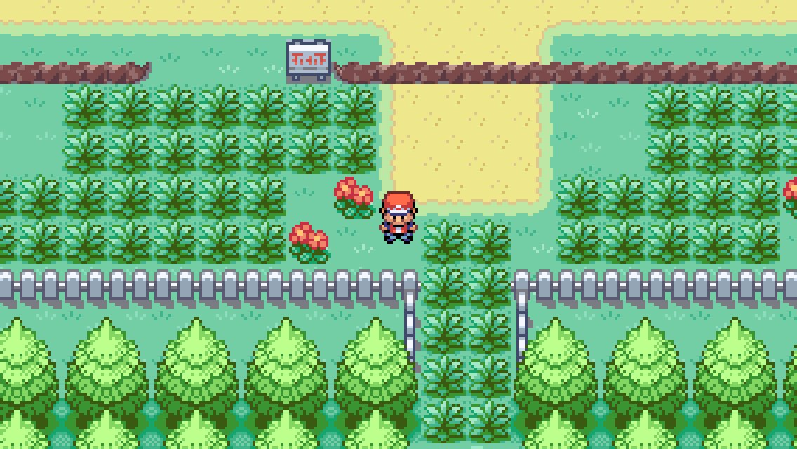
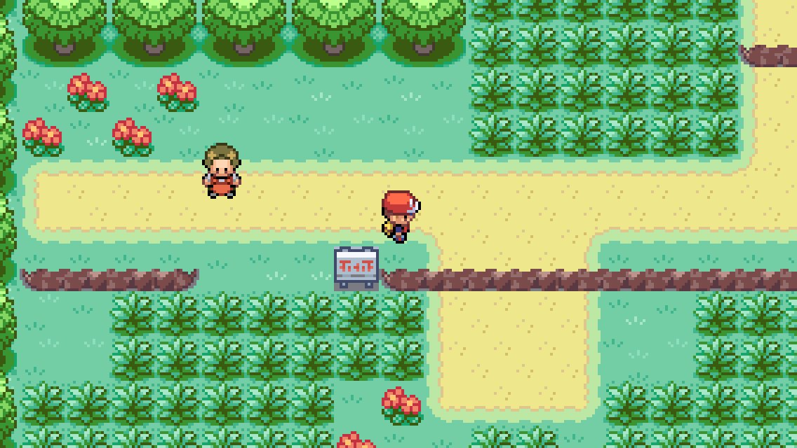
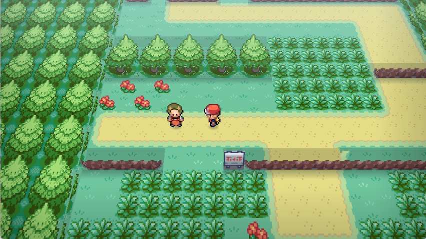
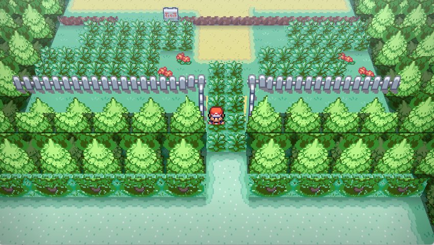
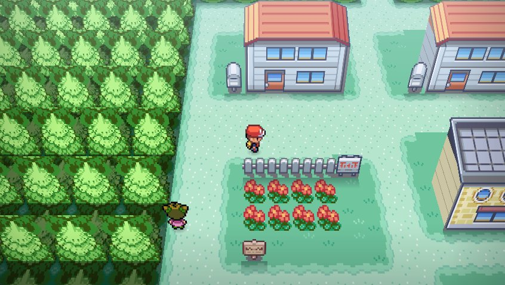
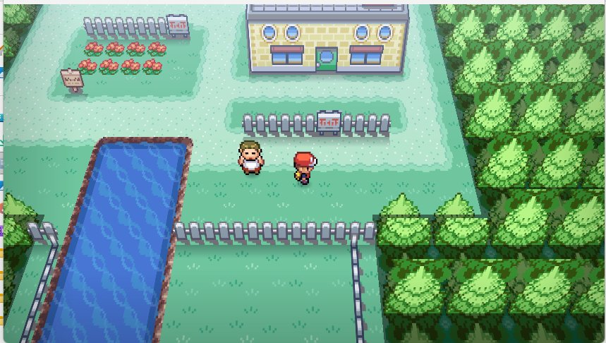
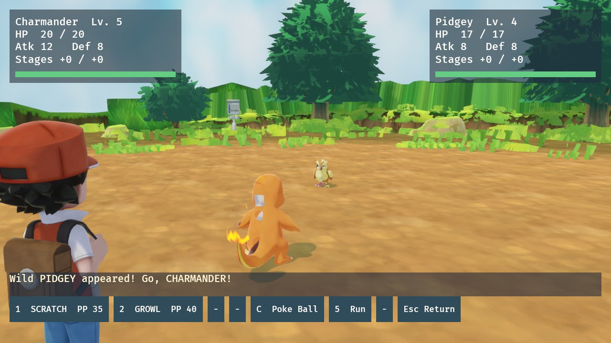
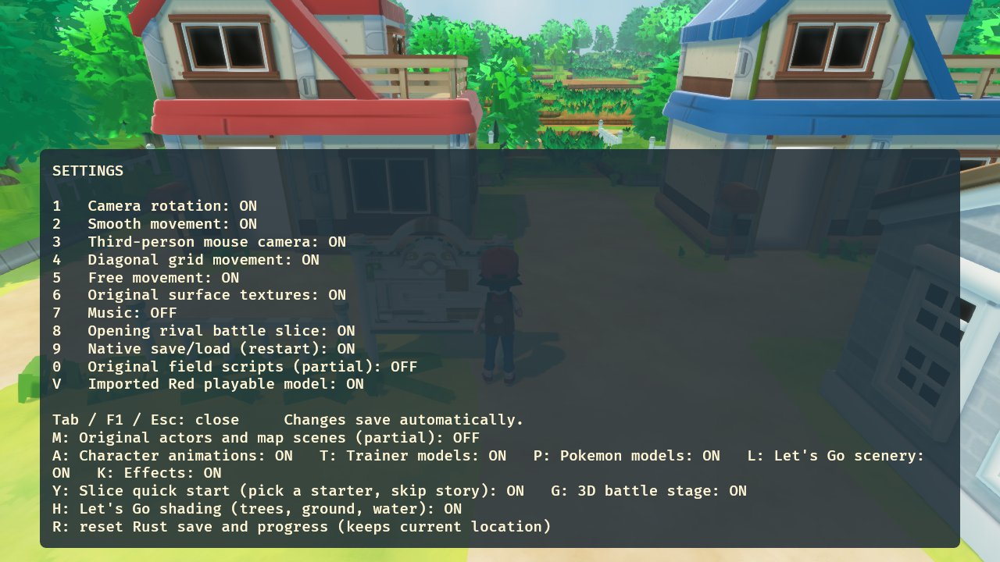

# FireRed Remake and Remaster

**Pokémon FireRed, rebuilt for PC: three projects in one repo.**


> [!IMPORTANT]
> **Everything here is a work in progress, and there are no downloads yet.** You can browse the code and follow along, but there are no builds to play.
>
> **This repo contains no copyrighted game content:** no ROMs, BIOS, saves, game data, models, textures or music. Any future version will need your own legally obtained copy of the game. Please don't ask for game files or share them in issues.

## Table of Contents

- [The three projects](#the-three-projects)
- [1. FireRed Remaster](#1-firered-remaster)
- [2. FireRed Native (Rust rewrite)](#2-firered-native-rust-rewrite)
- [3. FireRed Let's Go Remake](#3-firered-lets-go-remake)
- [Status](#status)
- [FAQ](#faq)
- [For developers](#for-developers)
- [Projects referenced and thanks](#projects-referenced-and-thanks)
- [Legal](#legal)

## The three projects

| | What it is | Runs the original code? |
|---|---|---|
| **[FireRed Remaster](#1-firered-remaster)** | The original GBA game, statically recompiled into a native Windows program, with optional PC features on top | Yes, recompiled to C++ |
| **[FireRed Native](#2-firered-native-rust-rewrite)** | FireRed's game logic rewritten in Rust as a standalone, renderer-free library, ported from the decomp | No, rewritten from scratch |
| **[FireRed Let's Go Remake](#3-firered-lets-go-remake)** | A 3D game built on the FireRed Native library, using Pokémon: Let's Go models, maps and animations | No, uses the Rust library |

---

## 1. FireRed Remaster

### Overview

The Remaster *is* Pokémon FireRed (USA), but running as a native PC program instead of in an emulator. The game's ARM/Thumb code is translated into C++ ahead of time using [gbarecomp](https://github.com/mstan/gbarecomp), so every rule, script and bug behaves exactly like the cartridge. Everything new sits on top as presentation, and **every extra can be switched on or off in-game**. With everything off, it's simply FireRed in widescreen.

### Screenshots: the game with every extra switched off

| | |
|---|---|
|  |  |
| Pallet Town in native 16:9 widescreen | Viridian City |
|  |  |
| Route 1's tall grass | Route 1, further north |

### Settings and UI rundown

All settings live inside the game's own menus and are saved to `config.ini` automatically. There are three ways in:

- **In game:** press **Esc**, or open the Start menu → **OPTION**, then switch to the second page (Game / System tabs).
- **Title screen:** the title menu has its own **OPTION** entry.
- **First launch:** a one-time setup screen lets you pick the main options before you start.

Navigation: **L / R** switches category, **B or right-click** goes back one level, **Esc** (or the controller's Guide button) returns straight to the game. The mouse can hover and click every row.

#### System

| Setting | Options | What it does |
|---|---|---|
| Display Mode | Window / Borderless / Fullscreen | How the game window is shown |
| Widescreen | On / Off | 16:9 view that shows extra map columns; off gives the original 3:2 |
| Window Size | Scale | Window size in windowed mode |
| Smoothing | On / Off | Pixel filtering when scaling |
| Interface | Submenu | Classic or modern UI for each part of the game (see below) |
| Volume | 0–100 | Master volume |
| Auto Run | On / Off | Run without holding the run button |
| Mouse Control | On / Off | Hover and click menus, scroll lists with the wheel |
| Extras | Submenu | Fast forward, Rare Candy, 3D view (see below) |
| Controls | Submenu | Keyboard and controller bindings (see below) |
| Quit Game | Press twice | Closes the game |

#### Interface: Classic or Modern for each part

Each part of the UI can be switched on its own between **Classic** (the original GBA look) and **Modern** (a sharp HD redraw at full resolution):

| Setting | Covers | `config.ini` key |
|---|---|---|
| Battles | Battle HUD, HP bars, move and command menus | `hd_battle` |
| Dialogue Boxes | Text boxes for NPCs, signs and story | `hd_dialogue` |
| Field Menus | Start menu and other in-field menus | `hd_text` |
| Title Menu | Title screen menu (Continue, New Game, Option) | `hd_title` |
| Pokédex | Pokédex list and entry pages | `hd_dex` |
| Menus & Screens | Full-screen menus and screens | `hd_screens` |
| Text Style | Classic pixel font or modern font | `modern_text` |

#### Extras

| Setting | Options | `config.ini` key |
|---|---|---|
| Fast Forward Speed | 2×, 3×, 4×, 5×, 6×, 8×, 10× (music mutes while active) | `ff_speed` |
| Fast Forward Key | Any key you press | `ff_key` |
| Key Mode | Hold / Toggle | `ff_toggle` |
| Infinite Rare Candy | On / Off: the Bag always keeps 99 Rare Candies | `rare_candy` |
| 3D View (test) | On / Off: also toggled any time with **F3** | `diorama` |

#### Controls

| Setting | Options |
|---|---|
| Controller Buttons | Xbox or Nintendo A/B layout |
| Left Stick Moves | On / Off |
| Confirm, Back, Menu, Use Item, Up, Down, Left, Right, L, R | Rebind each to any key |
| Restore Default Keys | Back to the default WASD + arrow keys layout |

#### Experimental 3D view

The **3D View** extra (or **F3**) uses a multithreaded software renderer to turn the 2D map into a tilted 3D diorama. The game underneath is unchanged:

| | |
|---|---|
|  |  |
|  |  |

---

## 2. FireRed Native (Rust rewrite)

### Overview

FireRed Native is FireRed's **game logic rewritten in Rust**, ported by hand from the [pret/pokefirered](https://github.com/pret/pokefirered) decompilation (pinned to revision `037335f4`), with its data imported from the decomp and checked against the original ROM.

The core is a **plain Rust library with no renderer, emulator or GBA runtime**: just the rules of the game as ordinary Rust types and functions. That makes it usable on its own: for a different engine, a fan game, a battle simulator, a bot, a randomiser or tooling. The Let's Go Remake is one front-end built on top of it.

Where behaviour comes from a specific function in the decomp, the Rust code names it (for example `CalculateBaseDamage`, `CreateMon`, `TryStandardWildEncounter`, `ScrCmd_*`), so you can check the port against the original C.

### How much has been ported

**Status: 🚧 work in progress.** Library code so far is about **7,800 lines of Rust** with **73 automated tests**.

| System | Ported from (pokefirered) | Progress |
|---|---|---|
| **Maps and movement:** collision, elevation, ledges, doors, warps, map connections, walk/run timing | `field_player_avatar.c`, `event_object_movement.c`, `field_control_avatar.c` | ✅ Done. **180 maps** imported (103,723 cells, 554 NPCs) |
| **Pokémon data:** species, moves, items, natures, growth rates | `src/data/` | ✅ All imported: **411 species, 356 moves, 375 items** |
| **Pokémon creation and stats:** CreateMon, personality/IVs/nature, stat formula, EXP and levels, starting movesets, PP | `pokemon.c` | ✅ Done |
| **Party, PC and Bag:** give Pokémon, 14 PC boxes × 30, bag pockets, money | `pokemon_storage_system.c`, `item.c` | ✅ Done |
| **Pokédex:** seen/caught flags, Kanto/National counts | `pokedex.c` | ✅ Done |
| **Field script VM:** runs FireRed's original event scripts (flags, vars, text, items, trainers, movement) | `script.c`, `scrcmd.c` | 🔨 **~109 of 213 script commands (~51%)**. All 9,731 script labels and 4,580 text entries imported |
| **Wild encounters:** encounter rate, cooldown, slot and level rolls, Repel, flutes, ability modifiers, nature/personality generation | `wild_encounter.c` | ✅ Land and cave encounters done (124 encounter tables imported). ⏳ Surfing, fishing and Rock Smash not yet |
| **Battle engine:** damage formula, physical/special split, full type chart, STAB, stat stages, accuracy/evasion, critical hits, turn order | `battle_util.c`, `battle_script_commands.c` | 🔨 Core maths done |
| **Move effects** | `battle_script_commands.c`, `data/battle_scripts_1.s` | 🔨 **24 of 214 effects (~11%)**: poison, burn, paralysis, sleep, freeze, confusion, stat changes, drain, healing and more |
| **Status conditions:** poison/toxic, burn, paralysis, sleep, freeze; field poison steps | `battle_util.c`, `field_poison.c` | ✅ Done (except a few ability interactions) |
| **Catching and fleeing:** catch formula, ball bonuses, shake checks, run odds | `battle_script_commands.c`, `battle_main.c` | ✅ Done (Safari Ball pending) |
| **Trainer AI** | `battle_ai_script_commands.c` | 🔨 Early-game commands only |
| **Whiteout, respawn, money loss** | `overworld.c` | ✅ Done |
| **Random number generator:** global RNG stream, persisted like the original | `random.c` | ✅ Done |
| **Saves** | `save.c` | ✅ Native save format (not compatible with GBA `.sav` files) |
| **Not started yet** | | ⏳ Evolution, HM field moves (Surf, Cut, etc.), Safari Zone, most items, double battles, later-game systems |

### Using it as a library

The crate is `firered-native-prototype` in [`rust-prototype/`](rust-prototype). Turn off the default `renderer` feature to get only the game logic, without Bevy:

```toml
[dependencies]
firered-native-prototype = { path = "rust-prototype", default-features = false }
```

```rust
use firered_native_prototype::{Game, Input, World, NORTH};

let world = World::load(std::path::Path::new("data/world.json"))?; // generated, see below
let mut game = Game::new(&world, "pallet");
game.tick(&world, Input { direction: Some(NORTH), run: false, interact: false });
println!("{} {:?}", game.map, game.position);
```

Modules: `lib` (world, collision, movement), `core` (Pokémon, party, storage, bag, Pokédex), `field` (script VM), `encounter` (wild encounters), `battle` (battle engine and AI), `actors` (NPCs and scenes). Game data (`data/*.json`) isn't included. Generate it with `rust-prototype/tools/import_*.py` before building, because the tables are compiled into the library.

---

## 3. FireRed Let's Go Remake

### Overview

The Let's Go Remake is FireRed Native with its visuals replaced by models, maps and animations from **Pokémon: Let's Go, Pikachu! / Eevee!**, converted from your own copy of the game with the importer in this repo. Underneath, it's still FireRed: same maps, same NPCs, same encounters, same battle maths.

### Screenshots

| | |
|---|---|
|  |  |
| Pallet Town with Let's Go scenery, FireRed's NPCs and collision | Route 1, seamless from Pallet Town |
|  |  |
| Wild battle with Let's Go Pokémon models and animations | Let's Go layers, effects and models can each be toggled |

### Features

- **Let's Go scenery.** Pallet Town and Route 1 are built from Let's Go's own field models, fitted onto FireRed's map layout and terrain heights.
- **Let's Go characters.** Red, NPCs and Pokémon use Let's Go models with their real skeletons and animations (idle, walk, run, attack, hurt, faint).
- **Seamless world.** No loading zones between connected outdoor areas.
- **Modern rendering.** HDR, bloom, shadows, anti-aliasing and wind sway (switchable).
- **Importer.** A pure-Python converter for Let's Go's GFPAK / GFBMDL / GFBANM / BNTX formats to glTF; no other tools are needed.

---

## Status

**Everything is a work in progress.**

| Project | Status |
|---|---|
| FireRed Remaster | 🚧 Work in progress |
| FireRed Native (Rust) | 🚧 Work in progress |
| FireRed Let's Go Remake | 🚧 Work in progress |

There are no releases or downloads yet. Development notes are kept in [`docs/STATE.md`](docs/STATE.md).

## FAQ

#### Can I download and play this?
Not yet. Everything is still a work in progress and there are no releases. You're welcome to look through the code and watch progress.

#### Will there be downloads in the future?
Maybe. If there are, they'll contain only this project's own code. You'd need to supply your own legally obtained copy of the game.

#### Is this an emulator?
No. The Remaster turns the game's machine code into native C++ ahead of time (static recompilation). FireRed Native and the Let's Go Remake don't use the original code at all: they're a new Rust program that reimplements FireRed's logic from the decomp.

#### What's the difference between the three?
The Remaster *is* FireRed with PC features added. FireRed Native is a new engine that plays like FireRed. The Let's Go Remake is FireRed Native with Let's Go visuals.

#### Why Let's Go visuals with FireRed gameplay?
Let's Go is a modern 3D remake of the same region. Pairing its look with FireRed's original rules, maps and battles gives the best of both.

#### Will it cover the whole game?
That's the goal. The Remaster runs the full game, though it's still being polished. The Rust versions currently have Pallet Town and Route 1 fully playable, with battles and wild encounters.

#### Which platforms are supported?
Windows only for now.

#### Is this affiliated with Nintendo, Game Freak or The Pokémon Company?
No. It's an unofficial, non-commercial fan project made for fun and learning.

## For developers

<details>
<summary>Repository layout and building</summary>

| Folder | Contents |
|---|---|
| `FireRedLeafGreenRecomp/` | The Remaster. All remaster code is in `src/fr_*`. |
| `rust-prototype/` | FireRed Native and the Let's Go Remake (Rust + Bevy). |
| `rust-prototype/tools/import_*.py` | Rebuild the Rust game data from the decomp and your ROM. |
| `rust-prototype/tools/letsgo/` | The Let's Go importer (GFPAK / GFBMDL / GFBANM / BNTX → glTF). |
| `letsgo-pipeline/` | Earlier research scripts from working out the Let's Go formats. |
| `tools/`, `docs/`, `deps/` | Build scripts, design notes, bundled SDL2 + toml++. |

Building needs your own game files. Generated code, game data and assets are not in the repo.

- **Remaster:** `tools\SETUP.bat` once, then `tools\build.bat` (see [`docs/BUILD.md`](docs/BUILD.md)).
- **Rust:** run `rust-prototype/tools/import_*.py`, then `rust-prototype/tools/letsgo/import_letsgo_*.py` for the Let's Go assets, then `rust-prototype\build.bat`.
- Launcher and box-art images can be copied from [mstan/recomp-ui](https://github.com/mstan/recomp-ui).

</details>

## Projects referenced and thanks

- [pret/pokefirered](https://github.com/pret/pokefirered): the FireRed decompilation everything here is checked against
- [mstan/gbarecomp](https://github.com/mstan/gbarecomp) and [FireRedLeafGreenRecomp](https://github.com/mstan/FireRedLeafGreenRecomp): the static recompiler the Remaster is built on
- [mstan/recomp-ui](https://github.com/mstan/recomp-ui): launcher UI
- [Bevy](https://bevyengine.org/): the Rust game engine
- [SDL2](https://www.libsdl.org/), [toml++](https://github.com/marzer/tomlplusplus), [Dear ImGui](https://github.com/ocornut/imgui)

## Legal

This is an unofficial fan project and is not for sale. Pokémon is © Nintendo / Creatures Inc. / Game Freak / The Pokémon Company. This project is not affiliated with or endorsed by them. No copyrighted game content is included; screenshots are shown for documentation only.

`FireRedLeafGreenRecomp/`, `gbarecomp/` and `recomp-ui/` keep their upstream licence (PolyForm Noncommercial 1.0.0, see their `LICENSE` files). `deps/` keep their own licences.
