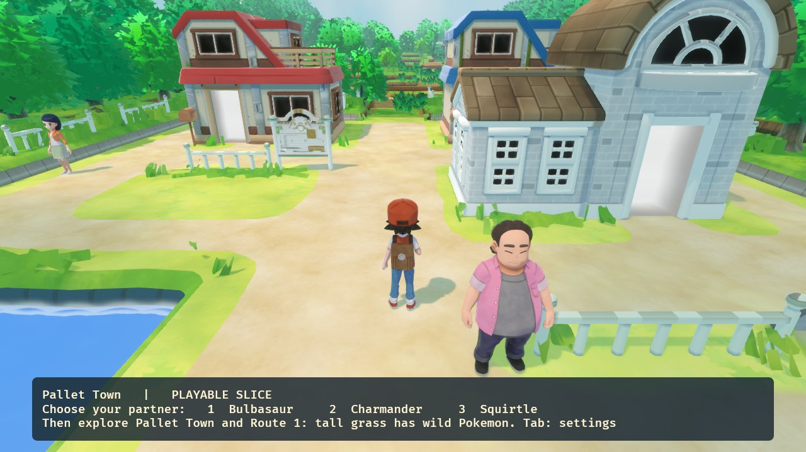
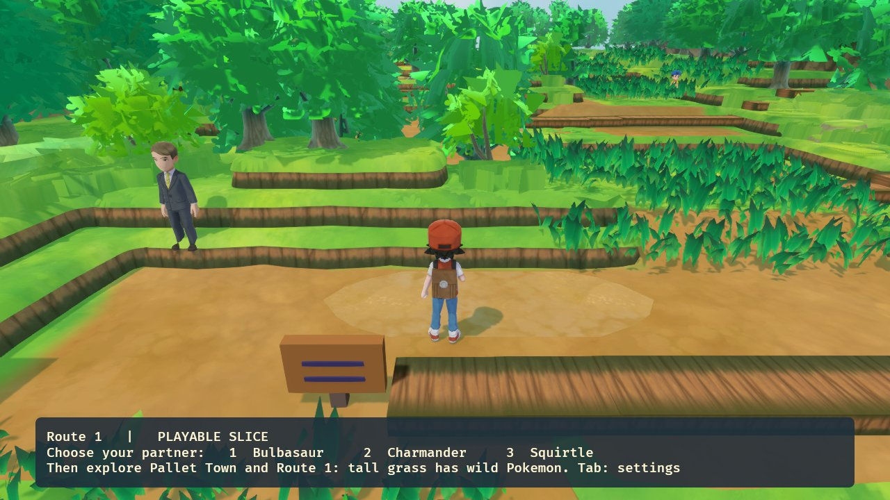

# FireRed Remake and Remaster

A personal, non-commercial fan project that brings Pokémon FireRed to PC in two ways:

- **The Remaster.** The original GBA game, statically recompiled to run natively on Windows. It adds a modern HD interface, 16:9 widescreen, keyboard/mouse/controller controls and an experimental 3D "diorama" overworld. The original game logic is untouched.
- **The Remake.** A from-scratch native **Rust** rewrite. FireRed's real game logic (maps, scripts, battles, RNG, encounters, saves) is ported from the [pret/pokefirered](https://github.com/pret/pokefirered) decomp into a full 3D world with a third-person camera. The visuals use Pokémon: Let's Go models and animations, built from your own copy of the game.

> **Code only. No game content is included.** See the [FAQ](#faq).

## Screenshots

### Remake (Rust, 3D)

| | |
|---|---|
|  |  |
| Pallet Town with Let's Go scenery and FireRed's NPCs and collision | Route 1, seamless from Pallet Town with no loading zone |
|  |  |
| Wild battle in Route 1's tall grass, using FireRed's battle maths | In-game settings: every feature can be switched on or off |

### Remaster (recompiled GBA game, 3D diorama view)

| | |
|---|---|
|  |  |
|  |  |

## Progress

### Remaster: playable, in daily use

| Feature | Status |
|---|---|
| Boots straight into the game, windowed/borderless/fullscreen | ✅ Done |
| 16:9 widescreen (extra map columns, checked against VRAM each frame) | ✅ Done |
| Keyboard (WASD + arrows), mouse hover/click on menus, controller + stick | ✅ Done (mouse needs a polish pass) |
| HD interface: battles, dialogue, field menus, title, Pokédex, naming screen | ✅ Done, each part switchable |
| Settings inside the game's OPTION screen + first-run setup | ✅ Done |
| Fast forward 2×–10× (hold or toggle) | ✅ Done |
| Infinite Rare Candy (optional) | ✅ Done |
| 3D diorama overworld (F3), multithreaded software renderer | 🧪 Experimental: the early towns and routes are modelled, the rest of the tilesets are still to do |
| HD Pokédex Area/Size page, HD evolution scene | ⏳ To do |

### Remake: Pallet Town + Route 1 slice playable

| Area | Status |
|---|---|
| World data: 137 maps imported from the decomp and checked against the ROM | ✅ Done |
| Field script VM (original scripts, flags, vars, text) | ✅ Running for the slice |
| Seamless outdoor areas (no loading zones between connected maps) | ✅ Done |
| Third-person 3D camera with mouse look, terrain-following | ✅ Done |
| Let's Go scenery for Pallet Town and Route 1, Let's Go trainer + Pokémon models with real animations | ✅ Done |
| Starter choice, wild grass encounters, catching, fleeing, whiteout | ✅ Done |
| Battle engine: Gen III damage, type chart, stat stages, accuracy, poison/burn/paralysis/sleep, trainer AI basics | 🔨 Partial: early-game moves and abilities work |
| Native saves (party, bag, PC boxes, Pokédex flags) | ✅ Done |
| HDR, bloom, shadows, wind sway (switchable) | ✅ Done |
| 73 automated checks | ✅ Passing |
| Viridian City onwards in Let's Go style, interiors, 3D battle stage, full story | ⏳ Next |

The full, detailed log is in [`docs/STATE.md`](docs/STATE.md).

## What's in the repo

| Folder | What it is |
|---|---|
| `FireRedLeafGreenRecomp/` | The remaster. All remaster code is in `src/fr_*`. Built on [gbarecomp](https://github.com/mstan/gbarecomp) + [recomp-ui](https://github.com/mstan/recomp-ui). |
| `rust-prototype/` | The Rust remake (Bevy). `tools/import_*.py` regenerate its game data from the decomp. |
| `rust-prototype/tools/letsgo/` | The Let's Go importer: GFPAK / GFBMDL / GFBANM / BNTX → glTF, pure Python. |
| `letsgo-pipeline/` | Earlier research and probe scripts from working out the Let's Go formats. |
| `tools/`, `docs/`, `deps/` | Build/deploy scripts, design notes, bundled SDL2 + toml++. |

## Building

You need your own legally obtained game files (see the FAQ).

- **Remaster:** `tools\SETUP.bat` once, then `tools\build.bat`. Details are in [`docs/BUILD.md`](docs/BUILD.md).
- **Remake:** generate `rust-prototype/data/` with `rust-prototype/tools/import_*.py`, build `rust-prototype/assets/` with `python rust-prototype/tools/letsgo/import_letsgo_field.py <your RomFS> assets/letsgo` (plus the other `import_letsgo_*.py`), then run `rust-prototype\build.bat` and `rust-prototype\run.bat`.

## FAQ

**Can I download this and play it?**
Not straight away. The repo has no ROM, game data or assets, so you have to supply your own and build it yourself. There are no prebuilt downloads.

**What do I need?**
For the remaster: a FireRed (USA, rev0) ROM dumped from your own cartridge (SHA-1 `41cb23d8dccc8ebd7c649cd8fbb58eeace6e2fdc`) and a GBA BIOS. For the remake's Let's Go visuals: the RomFS from your own copy of Pokémon: Let's Go. Please don't ask for these files, and don't post them in issues.

**Is it an emulator?**
No. The remaster turns the game's machine code into native C++ ahead of time (static recompilation). The remake doesn't use the original code at all: it's a fresh Rust program that reimplements FireRed's logic from the decomp.

**What's the difference between the remaster and the remake?**
The remaster *is* FireRed, running natively, with modern presentation added on top. The remake is a new game engine that aims to play exactly like FireRed but look like a modern 3D Pokémon game.

**Why do the remake's Pokémon look like Let's Go but play like FireRed?**
That's the goal: Let's Go's models, maps and animations for the look; FireRed's rules, maps, encounters and battle maths underneath.

**Will it cover the whole game?**
That's the plan, but the remake is early. Right now Pallet Town and Route 1 are fully playable with battles and wild encounters.

**Which platforms are supported?**
Windows only for now.

**Is this affiliated with Nintendo / Game Freak / The Pokémon Company?**
No. It's an unofficial fan project, made for fun and learning, and is not for sale.

## Licences

`FireRedLeafGreenRecomp/`, `gbarecomp/` and `recomp-ui/` keep their upstream licence (PolyForm Noncommercial 1.0.0, see their `LICENSE` files). `deps/` keep their own licences. Pokémon is © Nintendo / Creatures / Game Freak / The Pokémon Company. Screenshots are shown for documentation only. Missing launcher/box-art images can be copied from [mstan/recomp-ui](https://github.com/mstan/recomp-ui).
