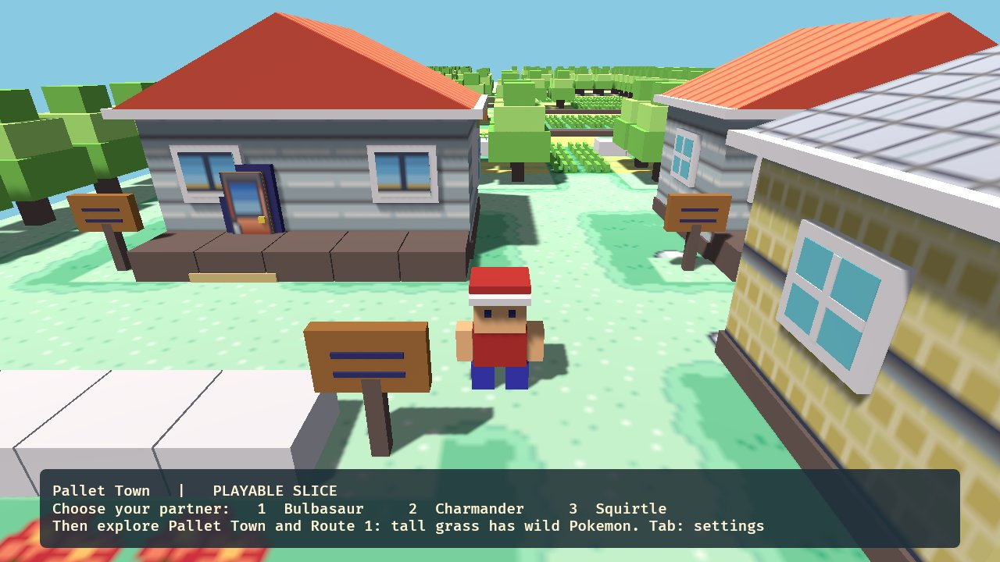
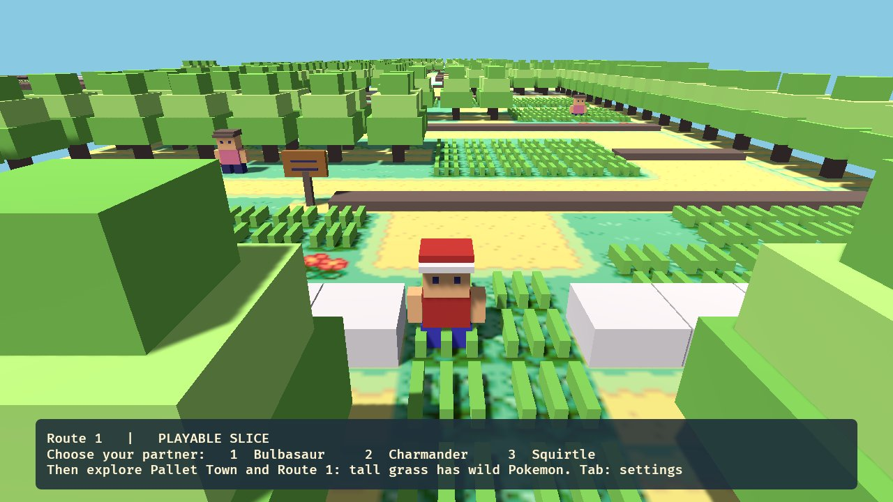
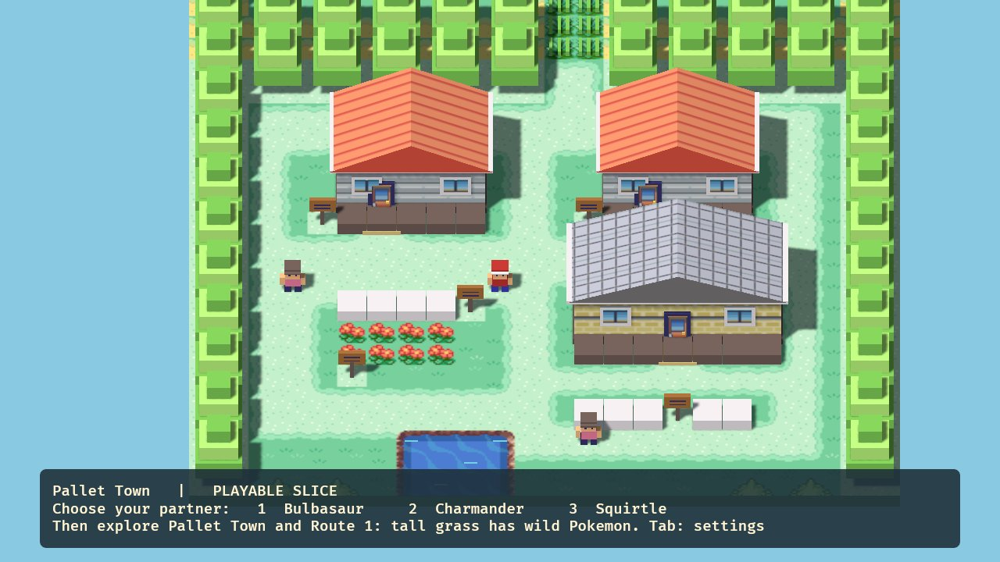
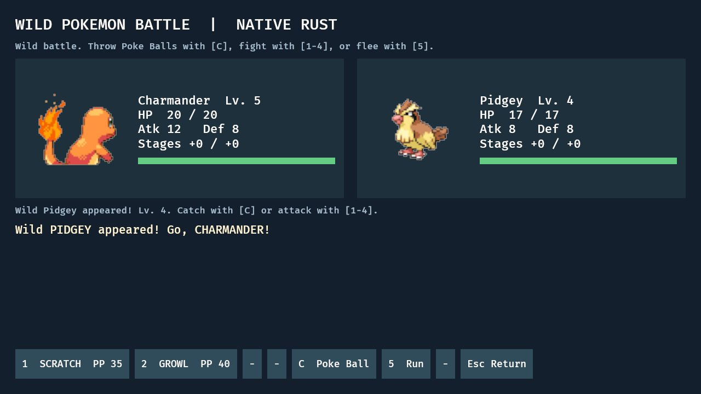
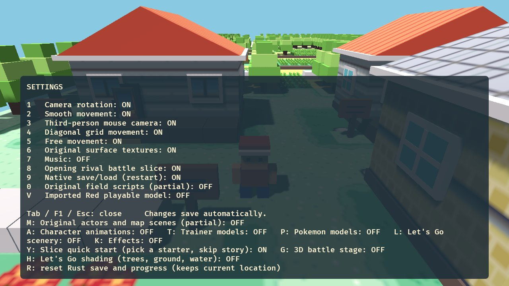

# FireRed Remake and Remaster

**Pokémon FireRed, rebuilt for PC: three projects in one repo.**

> [!IMPORTANT]
> **Everything here is a work in progress, and there are no downloads yet.** You can browse the code and follow along, but there are no builds to play.
>
> **This repo contains no copyrighted game content:** no ROMs, BIOS, saves, game data, models, textures or music. Any future version will need your own legally obtained copy of the game. Please don't ask for game files or share them in issues.

## Table of Contents

- [The three projects](#the-three-projects)
- [1. FireRed Remaster](#1-firered-remaster)
- [2. FireRed Native (Rust rewrite)](#2-firered-native-rust-rewrite)
- [3. FireRed Let's Go Remake](#3-firered-lets-go-remake)
- [Status](#status)
- [FAQ](#faq)
- [For developers](#for-developers)
- [Projects referenced and thanks](#projects-referenced-and-thanks)
- [Legal](#legal)

## The three projects

| | What it is | Runs the original code? | Look |
|---|---|---|---|
| **[FireRed Remaster](#1-firered-remaster)** | The original GBA game, statically recompiled into a native Windows program, with PC features added | Yes, recompiled | Original 2D, widescreen, optional HD UI and 3D view |
| **[FireRed Native](#2-firered-native-rust-rewrite)** | A brand-new engine written in Rust that reimplements FireRed's logic from the decomp | No, rewritten from scratch | FireRed's own tiles and sprites, in 3D or top-down |
| **[FireRed Let's Go Remake](#3-firered-lets-go-remake)** | FireRed Native, dressed in Pokémon: Let's Go models, maps and animations | No, same Rust engine | Modern 3D, Let's Go style |

The Native rewrite and the Let's Go Remake are the same program: the Let's Go look is a layer of switchable settings on top of the plain Native game.

---

## 1. FireRed Remaster

### Overview

The Remaster *is* Pokémon FireRed (USA), but running as a native PC program instead of in an emulator. The game's ARM/Thumb code is translated into C++ ahead of time using [gbarecomp](https://github.com/mstan/gbarecomp), so every rule, script and bug behaves exactly like the cartridge. All the new features sit on top as presentation, and every one can be switched off in the game's own OPTION menu.

### Screenshots: the game running with every extra switched off

| | |
|---|---|
|  |  |
| Pallet Town in native 16:9 widescreen | Viridian City |
|  |  |
| Route 1's tall grass | Route 1, further north |

### Features

- **Native PC program.** Boots straight into the game; windowed, borderless or fullscreen.
- **16:9 widescreen.** Draws extra map columns, checked against the real video memory every frame.
- **PC controls.** Keyboard (WASD + arrows), mouse hover and click on menus, controller with analog stick.
- **Optional HD interface.** Sharp modern battles, dialogue, menus, title screen and Pokédex, each switchable on its own.
- **Quality of life.** Fast forward 2×–10×, optional infinite Rare Candy, settings built into the OPTION screen.
- **Experimental 3D "diorama" view** (F3). A multithreaded software renderer turns the 2D map into a tilted 3D scene:

| | |
|---|---|
|  |  |
|  |  |

---

## 2. FireRed Native (Rust rewrite)

### Overview

FireRed Native is a from-scratch reimplementation of FireRed in **Rust** (using the Bevy engine). It doesn't run the original code at all. Instead, the game's logic is ported by hand from the [pret/pokefirered](https://github.com/pret/pokefirered) decompilation, and its maps, scripts and data are imported and checked against the original ROM. The aim is a game that plays *exactly* like FireRed but is free to look and control like a modern PC game.

### Screenshots: plain Native mode (no Let's Go assets, no effects)

| | |
|---|---|
|  |  |
| Pallet Town in 3D, third-person camera | Route 1, with no loading zone from Pallet |
|  |  |
| Classic top-down camera | A wild battle using FireRed's battle maths |

### Features

- **The real FireRed world.** 137 maps imported from the decomp and verified against the ROM: collision, warps, NPCs, signs and triggers.
- **Original scripts.** A native script VM runs FireRed's own event scripts, flags and text.
- **Battles.** Generation III damage formula, full type chart, stat stages, accuracy, critical hits, status conditions (poison, burn, paralysis, sleep) and early trainer AI.
- **Wild Pokémon.** Grass encounters with the original rates and RNG, catching with real ball maths, fleeing, whiteout.
- **Native saves.** Party, bag, PC boxes and Pokédex.
- **Camera your way.** Third-person with mouse look, or the classic top-down grid. Free or grid movement, with optional diagonals.
- **Everything is switchable.** An in-game settings panel turns each feature on or off:

---

## 3. FireRed Let's Go Remake

### Overview

The Let's Go Remake is FireRed Native with its visuals replaced by models, maps and animations from **Pokémon: Let's Go, Pikachu! / Eevee!**, converted from your own copy of the game with the importer in this repo. Underneath, it's still FireRed: same maps, same NPCs, same encounters, same battle maths.

### Screenshots

| | |
|---|---|
|  |  |
| Pallet Town with Let's Go scenery, FireRed's NPCs and collision | Route 1, seamless from Pallet Town |
|  |  |
| Wild battle with Let's Go Pokémon models and animations | Let's Go layers, effects and models can each be toggled |

### Features

- **Let's Go scenery.** Pallet Town and Route 1 are built from Let's Go's own field models, fitted onto FireRed's map layout and terrain heights.
- **Let's Go characters.** Red, NPCs and Pokémon use Let's Go models with their real skeletons and animations (idle, walk, run, attack, hurt, faint).
- **Seamless world.** No loading zones between connected outdoor areas.
- **Modern rendering.** HDR, bloom, shadows, anti-aliasing and wind sway (switchable).
- **Importer.** A pure-Python converter for Let's Go's GFPAK / GFBMDL / GFBANM / BNTX formats to glTF; no other tools are needed.

---

## Status

**Everything is a work in progress.**

| Project | Status |
|---|---|
| FireRed Remaster | 🚧 Work in progress |
| FireRed Native (Rust) | 🚧 Work in progress |
| FireRed Let's Go Remake | 🚧 Work in progress |

There are no releases or downloads yet. Development notes are kept in [`docs/STATE.md`](docs/STATE.md).

## FAQ

#### Can I download and play this?
Not yet. Everything is still a work in progress and there are no releases. You're welcome to look through the code and watch progress.

#### Will there be downloads in the future?
Maybe. If there are, they'll contain only this project's own code. You'd need to supply your own legally obtained copy of the game.

#### Is this an emulator?
No. The Remaster turns the game's machine code into native C++ ahead of time (static recompilation). FireRed Native and the Let's Go Remake don't use the original code at all: they're a new Rust program that reimplements FireRed's logic from the decomp.

#### What's the difference between the three?
The Remaster *is* FireRed with PC features added. FireRed Native is a new engine that plays like FireRed. The Let's Go Remake is FireRed Native with Let's Go visuals.

#### Why Let's Go visuals with FireRed gameplay?
Let's Go is a modern 3D remake of the same region. Pairing its look with FireRed's original rules, maps and battles gives the best of both.

#### Will it cover the whole game?
That's the goal. The Remaster runs the full game, though it's still being polished. The Rust versions currently have Pallet Town and Route 1 fully playable, with battles and wild encounters.

#### Which platforms are supported?
Windows only for now.

#### Is this affiliated with Nintendo, Game Freak or The Pokémon Company?
No. It's an unofficial, non-commercial fan project made for fun and learning.

## For developers

Repository layout and building

| Folder | Contents |
|---|---|
| `FireRedLeafGreenRecomp/` | The Remaster. All remaster code is in `src/fr_*`. |
| `rust-prototype/` | FireRed Native and the Let's Go Remake (Rust + Bevy). |
| `rust-prototype/tools/import_*.py` | Rebuild the Rust game data from the decomp and your ROM. |
| `rust-prototype/tools/letsgo/` | The Let's Go importer (GFPAK / GFBMDL / GFBANM / BNTX → glTF). |
| `letsgo-pipeline/` | Earlier research scripts from working out the Let's Go formats. |
| `tools/`, `docs/`, `deps/` | Build scripts, design notes, bundled SDL2 + toml++. |

Building needs your own game files. Generated code, game data and assets are not in the repo.

- **Remaster:** `tools\SETUP.bat` once, then `tools\build.bat` (see [`docs/BUILD.md`](docs/BUILD.md)).
- **Rust:** run `rust-prototype/tools/import_*.py`, then `rust-prototype/tools/letsgo/import_letsgo_*.py` for the Let's Go assets, then `rust-prototype\build.bat`.
- Launcher and box-art images can be copied from [mstan/recomp-ui](https://github.com/mstan/recomp-ui).

## Projects referenced and thanks

- [pret/pokefirered](https://github.com/pret/pokefirered): the FireRed decompilation everything here is checked against
- [mstan/gbarecomp](https://github.com/mstan/gbarecomp) and [FireRedLeafGreenRecomp](https://github.com/mstan/FireRedLeafGreenRecomp): the static recompiler the Remaster is built on
- [mstan/recomp-ui](https://github.com/mstan/recomp-ui): launcher UI
- [Bevy](https://bevyengine.org/): the Rust game engine
- [SDL2](https://www.libsdl.org/), [toml++](https://github.com/marzer/tomlplusplus), [Dear ImGui](https://github.com/ocornut/imgui)

## Legal

This is an unofficial fan project and is not for sale. Pokémon is © Nintendo / Creatures Inc. / Game Freak / The Pokémon Company. This project is not affiliated with or endorsed by them. No copyrighted game content is included; screenshots are shown for documentation only.

`FireRedLeafGreenRecomp/`, `gbarecomp/` and `recomp-ui/` keep their upstream licence (PolyForm Noncommercial 1.0.0, see their `LICENSE` files). `deps/` keep their own licences.
