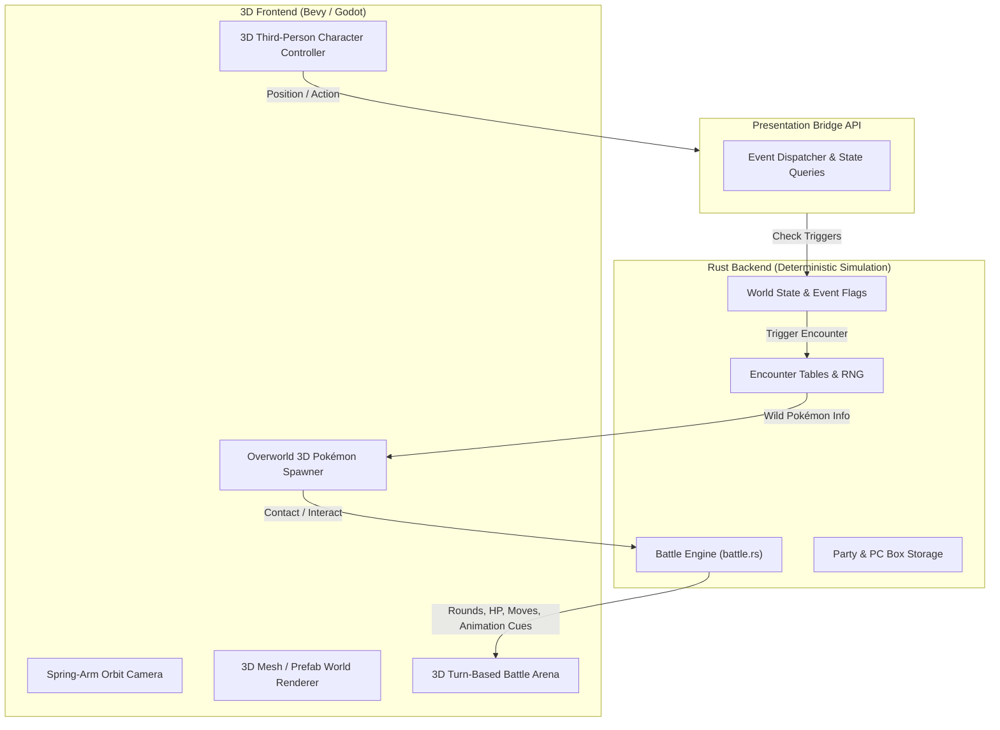

# Pokémon FireRed 3D Remake — Technical & Design Architecture

**Document Version:** 1.1  
**Context:** Successor roadmap following the completion of the faithful native Rust logic rewrite (`rust-prototype/`).  
**Author:** Antigravity / Gemini & Ben

---

## 1. Executive Vision

Transform the static/2D recompiled Pokémon FireRed into a **modern, full third-person 3D action/RPG-style remake** on PC, while retaining the deep mathematical accuracy, battle rules, and event logic of the original Generation III FireRed.

### Core Pillars
1. **Art Direction - "Let's Go" Parity**: The visual style will directly mirror *Pokémon: Let's Go, Pikachu! / Eevee!* (LGPE). This provides a bright, stylized aesthetic and ensures a mathematically perfect 1:1 architectural parity with Kanto's original map grid.
2. **Third-Person Explorable Kanto**: Full 3D camera with mouse/right-stick control, free WASD/analog movement, natural terrain slopes, dynamic lighting, and weather.
3. **Preserved Core Engine**: The native Rust engine (`src/battle.rs`, `src/core.rs`, `src/encounter.rs`, and party state) powers all backend calculations, battles, stats, AI, and game flags with zero emulation overhead.
4. **Overworld Pokémon & Riding**: Visible wild Pokémon roaming routes matching the source encounter tables; mountable Pokémon riding (ground, surfing, flying) utilizing official LGPE mount animations.

---

## 2. Asset Pipeline: 3D Pokémon & Environments

**Decision Matrix:** We have officially decided to source all primary assets directly from the Nintendo Switch *Let's Go* game files. While extraction is technically involved, it is the *only* way to guarantee perfect Kanto scale, layout accuracy, and style consistency.

### A. Environment & World Assets (LGPE Extraction)
Because LGPE is a direct 1:1 remake of Kanto, the building dimensions, outdoor route layouts, and landmarks map perfectly to FireRed's grid.
* **Modular Prefab Kit**: We will extract the base 3D prefabs for Pokémon Centers, Poké Marts, Gyms, Celadon Dept Store, Pallet Town houses, cut trees, ledge fences, and signs.
* **Automated Map Translation**: Since `rust-prototype/data/world.json` already contains all 180+ maps with exact tile coordinates (x, y) and elevations, we can map the extracted LGPE 3D prefabs directly to our JSON coordinates to instantly build the Kanto overworld without manual placement.

### B. Pokémon Models, Rigs & Animations (LGPE Extraction)
LGPE contains all 151 Gen 1 Pokémon with high-quality walk/run cycles, battle animations, and unique player riding animations.
* **Extraction Toolchain & Workflow**:
  1. **ROMFS Decryption**: Dump base NCA/NSP via Switch CFW using `hactool` / `prod.keys`.
  2. **Archive Unpacking**: Game Freak packages models inside `.gfpak` archives. We will use `Switch Toolbox` or Python extraction scripts (`gfpak_extractor`) to dump the raw files.
  3. **Format Conversion**: Convert Game Freak proprietary formats (`.gfbmdl` for models, `.bntx` for textures, `.gfbanm` for animations) into standard engine-ready `.glb` / `.gltf` files using `Switch Toolbox` or the `Blender GFModelImporter` plugin.
* **Fallback Strategy**: If specific extractions break or fail, we will use community rips from *The Models Resource* as a fallback, ensuring they match the LGPE aesthetic.

### C. Pokémon Riding Mechanics
* **Mount Sockets**: Extracted 3D Pokémon models have dedicated mount attachment nodes:
  * **Land Mounts** (Arcanine, Rapidash, Tauros, Dodrio): Speed multiplier, jump over low ledges.
  * **Water Mounts** (Lapras, Blastoise, Gyarados): Surface swimming.
  * **Air Mounts** (Charizard, Pidgeot, Dragonite): Hovering / low flight.
  * **Heavy Mounts** (Onix, Snorlax): Destroys / pushes heavy obstacles.
* **Player Animation Sockets**: The extracted LGPE player rig (Chase/Elaine) will switch to mounted idle/holding-reins poses attached to the Pokémon's mount bone.

---

## 3. Engine Architecture & Technology Choice

There are two viable technological routes for the 3D presentation layer:

| Feature | Option A: Native Bevy 3D (Rust Prototype) | Option B: Godot 4 + Rust GDExtension |
| :--- | :--- | :--- |
| **Language** | 100% Rust (Shared ECS) | GDScript / C# UI + Rust Core |
| **Tooling & Editor** | Code-driven (no visual scene editor) | Full visual 3D editor & terrain tools |
| **Data Bridge** | **Zero bridge overhead**; in-memory pointers | GDExtension C-ABI / shared library |
| **Rendering** | Bevy PBR, custom glTF pipelines | Godot Forward+ / Mobile Vulkan renderer |
| **Physics** | `bevy_rapier3d` or `avian3d` | Built-in Godot Jolt physics |
| **Suitability** | Best if keeping single unified codebase | Best for rapid visual world construction |

### Recommended Decision:
1. **Finish the Rust Logic Core**: Keep completing `battle.rs`, `encounter.rs`, `world.json`, and party state as an engine-agnostic library (`librust_fire_red`).
2. **Presentation Decoupling**: The Rust core exposes clean APIs:
   - `get_map(id)` -> layout, spawns, actors
   - `step(player_pos)` -> wild encounter triggers, script checks
   - `start_battle(wild_or_trainer)` -> turn-based state machine
   - `execute_move(move_id)` -> damage, accuracy, secondary effects
3. This allows the 3D frontend (whether Bevy or Godot) to plug into the Rust backend cleanly without rewriting core Pokémon logic.

---

## 4. Bridge Design: From 2D Grid to 3D World

### Key Integration Mechanics:
1. **Continuous 3D Collision**: Replace discrete tile bumping with capsule collider character physics + mesh colliders for buildings/slopes.
2. **Elevation to Verticality**: Convert GBA 2D elevations (0, 1, 2) into actual 3D heights ($Y = \text{elevation} \times 2.0\text{m}$).
3. **Overworld Pokémon Spawning**: Instead of random grass encounter math on a step, grass zones spawn visible 3D Pokémon instances with patrol AI. Walking into a Pokémon initiates the 3D battle sequence.
4. **Seamless Battle Arena**: The third-person camera rotates and transitions smoothly to an arena perspective on the spot, rather than cutting to a black screen.

---

## 5. Phased Roadmap

* **Phase 1: Rust Rewrite Baseline (Current Focus)**:
  * Complete full Kanto map imports, trainers, and battle mechanics.
  * Stabilize core data structures (`Pokemon`, `Move`, `Battle`, `World`).
* **Phase 2: 3D Asset Toolkit & Pipeline Setup (LGPE Extraction)**:
  * Establish the standard Switch ROMFS decryption and `.gfpak` extraction toolchain.
  * Convert the LGPE Gen 1 Pokémon, Red/Leaf player rigs, and riding animations into `.glb` formats.
  * Extract the core modular Kanto architectural assets (Pallet Town, Viridian, Pokémon Center, Mart).
* **Phase 3: 3D World Generation**:
  * Build an automated generator that reads `world.json` and generates the connected 3D Kanto landscape using the LGPE prefabs.
  * Implement the 3D third-person character controller and spring-arm camera.
* **Phase 4: Overworld Spawning & Riding Integration**:
  * Implement overworld roaming Pokémon driven by source encounter tables.
  * Build the player mounting system for Arcanine, Charizard, and Lapras.
* **Phase 5: 3D Battle Sequence & Animation Sync**:
  * Wire backend battle state rounds to visual 3D attack animations, hit reactions, and dynamic battle camera cuts.
